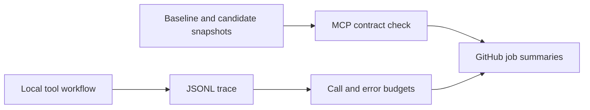

# agent-ci-starter

**A small, copyable workflow for checking tool interfaces before a change and recorded tool calls after a run.**

[中文说明](README.zh-CN.md) · [MCP checker](https://github.com/L1Huash1/mcp-changecheck) · [Trace checker](https://github.com/L1Huash1/agent-tracecheck)

[](https://github.com/L1Huash1/agent-ci-starter/actions/workflows/checks.yml)

This starter connects two local checks in one reproducible repository. It uses a **scripted local tool workflow**, not an autonomous LLM agent. No model, API key, MCP server or hosted tracing is needed. Installation downloads source dependencies; the demonstrations and checks run locally.



## Try locally

Python 3.13 and Git are used by the tested setup. Create and activate a virtual environment if desired, then:

```sh
git clone https://github.com/L1Huash1/agent-ci-starter.git
cd agent-ci-starter
python -m pip install -r requirements.txt

# Check the unchanged example interface
mcp-changecheck contracts/baseline.json contracts/candidate.json

# Record two real local function calls, then enforce budgets
python demo.py trace.jsonl
agent-tracecheck trace.jsonl --max-calls 4 --max-errors 0
```

`requirements.txt` pins reviewed GitHub source commits corresponding to mcp-changecheck v0.3.0 and agent-tracecheck v0.2.1. It does not assume a PyPI publication. The recorder exclusively creates new trace files; choose a new path when repeating a demonstration.

## See intentional failures

```sh
# Removed tool and newly required argument: intentionally exits 1
mcp-changecheck contracts/baseline.json contracts/breaking.json

# Record three repeated failures; recording itself succeeds
python demo.py retry-trace.jsonl --scenario retry

# The recorded errors exceed the default error budget: intentionally exits 1
agent-tracecheck retry-trace.jsonl
```

Use `--fail-on never` with either checker to inspect findings without failing the threshold. Invalid input still returns 2. Deliberate failure examples demonstrate the checkers; they are not model quality or performance benchmarks.

## Use GitHub checks

Fork or copy this repository and enable its [workflow](.github/workflows/checks.yml). It runs on Windows and Linux:

- `contracts` uses the **released external action** `L1Huash1/mcp-changecheck@v0.3.0` and writes a contract report to the job summary.
- `local-tools` installs the pinned source tools, runs regression tests, records the local demonstration and enforces call/error budgets. Its report is appended to the job summary.

The workflow needs `contents: read` only. No repository write permission or API key is required. No reports are posted as comments or uploaded as artifacts automatically.

To adopt it for your own project, replace `contracts/candidate.json` with a complete snapshot of your candidate tool interface and connect the recorder to your tool calls. Review baseline changes deliberately rather than automatically approving the current candidate as the baseline. The snapshots here describe local function interfaces in MCP snapshot shape; they are **not** captured from a running MCP server.

```sh
python -m unittest discover -s tests -v
```

The six regression tests exercise the actual installed CLIs, intentional failure statuses, trace preservation, and the example contract's parameter names. Parameter-name checks are not full runtime schema validation.

## Limits

Static contract checks do not prove complete JSON Schema compatibility. Recorded-call diagnostics depend on complete events and do not judge model answers. This example has no planner, model loop or live MCP transport. See the two checkers' documented rules before changing production thresholds.

MIT licensed. Initial development used AI coding assistance.
